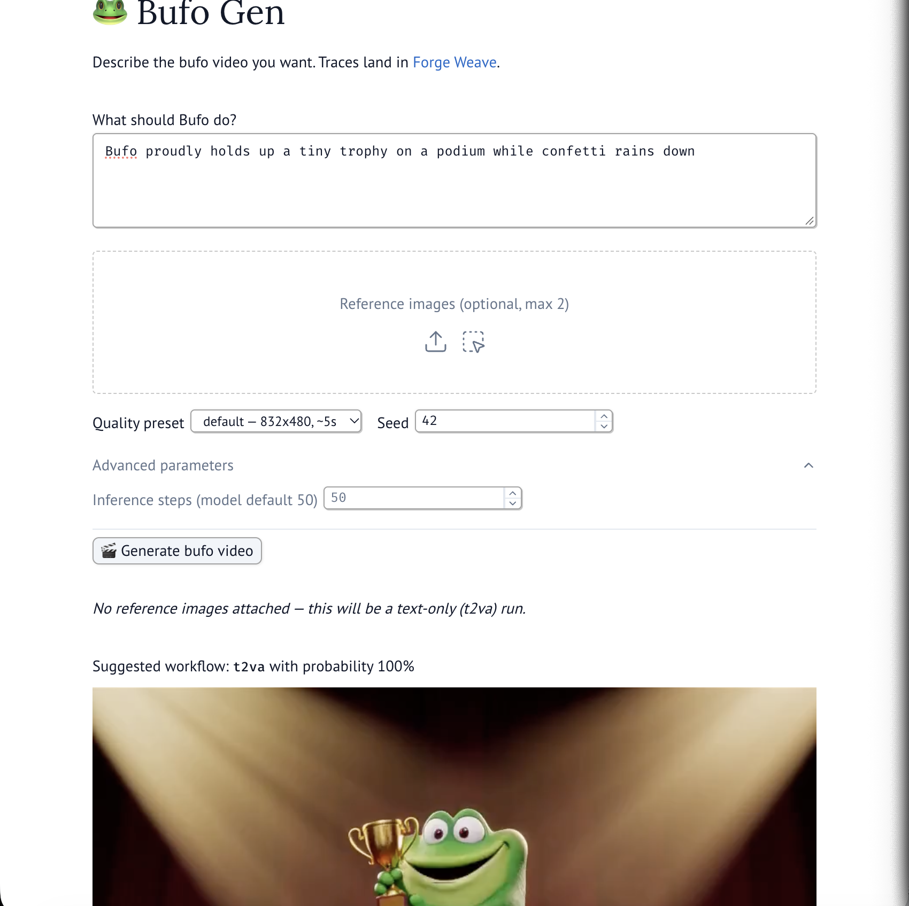
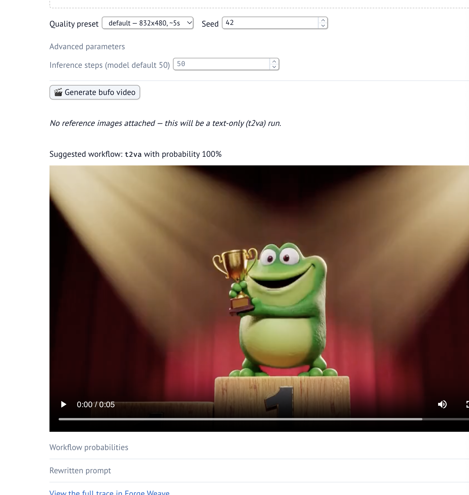
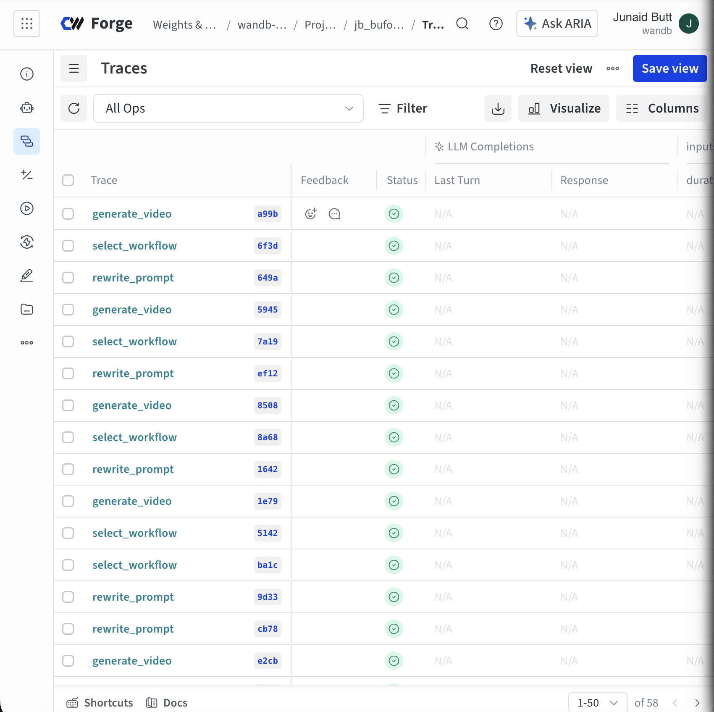
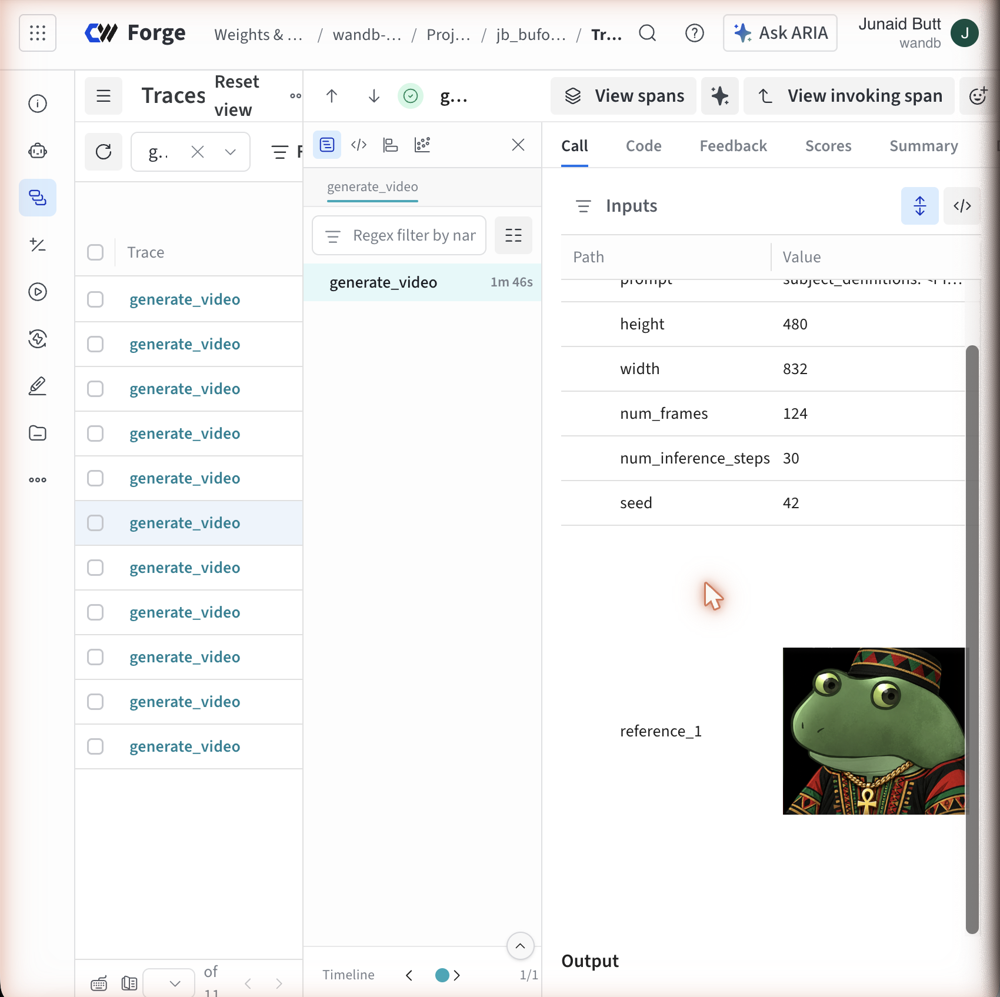
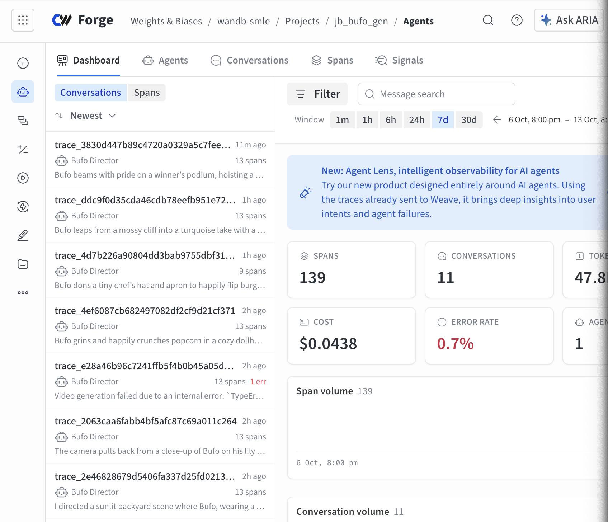

# 🐸 Bufo Gen

Describe a bufo video in plain words, optionally attach up to two reference
images, and get a generated clip — video *and* audio — back in the browser,
with the full pipeline traced end-to-end in Forge Weave.

Three models cooperate per request:

| Role | Model | Where it runs |
|---|---|---|
| Director agent + prompt rewriter | `moonshotai/Kimi-K2.6` | Forge Inference (`api.inference.wandb.ai`) |
| Workflow router | `convaiinnovations/laya` (non-autoregressive classifier) | CPU on the GPU node |
| Video+audio generation | `MiniMaxAI/MiniMax-H3` via diffusers Modular Pipelines | 2× H100 on the CoreWeave cluster |

```
marimo UI (cluster GPU node, reached via SSH tunnel)
   └─ Bufo Director agent (OpenAI Agents SDK, Kimi-K2.6) — orchestrates the crew
        ├─ 1. pick_workflow      Laya scores the task types on the user's
        │                        prompt → t2va / i2va / l2va / fl2va / ref2va
        ├─ 2. write_screenplay ─► Bufo Screenwriter agent
        │                           retrieves the MiniMax prompt guide (sliced
        │                           to the routed task) + the Bufo character
        │                           description, then writes the prompt
        └─ 3. shoot_video      ─► Bufo Cameraman agent
                                    renders the screenplay verbatim with
                                    MiniMax-H3 (video + audio)
   └─ result card in marimo; every step is a Weave trace and the three agents
      appear as one grouped session in the Weave Agents view
```

> 📖 **Deep-dive:** [docs/generation_workflow.md](docs/generation_workflow.md)
> details the full pipeline with diagrams — how Forge Inference rewrites
> prompts, how Laya routes the MiniMax task types, how MiniMax-H3 executes
> across the two GPUs, what Forge Weave traces, and the GPU requirements.

## Setup

### Prerequisites

- **Cluster access** — an SSH host alias `coreweave-login` for the CoreWeave
  SUNK (Slurm) login node, with your key installed.
- **uv on the login node** — dependencies install with [uv](https://docs.astral.sh/uv/).
  If `~/.local/bin/uv` doesn't exist there yet:
  `ssh coreweave-login 'curl -LsSf https://astral.sh/uv/install.sh | sh'`
- **Forge / W&B account** — a `WANDB_API_KEY` (used both for Weave tracing and
  to authenticate against Forge Inference for Kimi).
- **A Forge Weave project** — traces, evals and the Agents view live here.
  This repo defaults to **`wandb-smle/jb_bufo_gen`**; point it at your own
  project with `WANDB_ENTITY` / `WANDB_PROJECT` in `.env`.
- **Hugging Face token** — MiniMax-H3 is license-gated: accept the terms on
  [its model page](https://huggingface.co/MiniMaxAI/MiniMax-H3) first, then
  set `HF_TOKEN`.

### Manual setup (humans)

If your environment and directory structure is configured correctly, you can skip to step 4.

```bash
# 1. Clone and configure secrets. .env is synced to the cluster on purpose —
#    the app reads WANDB_API_KEY / HF_TOKEN there.
git clone <this repo> && cd bufo_gen
cp .env_example .env   # fill in WANDB_API_KEY, HF_TOKEN (and WANDB_ENTITY/
                       # WANDB_PROJECT if not using wandb-smle/jb_bufo_gen)

# 2. Mirror the repo to the cluster (rsync to coreweave-login:bufo_gen/).
./scripts/sync.sh

# 3. Install dependencies ON THE LOGIN NODE. uv lives at ~/.local/bin and is
#    not on PATH in non-interactive shells; compute nodes can't run uv at all.
ssh coreweave-login 'cd bufo_gen && ~/.local/bin/uv sync'

# 4. Allocate 2x H100 and start the app inside the allocation. Prints the job
#    id and the exact tunnel command for your laptop.
ssh coreweave-login 'cd bufo_gen && ./scripts/launch_cluster.sh'

# 5. On your laptop: tunnel to the compute node — run the EXACT command printed
#    by step 4 (it targets the node's IP; compute-node hostnames don't resolve).
# THIS WILL FREEZE YOUR TERMINAL! Don't be alarmed, it means its working, go to step 6
ssh -N -L 2718:<node-ip>:2718 coreweave-login

# 6. Open the app. The very first generation also downloads the ~124GB of
#    MiniMax-H3 weights from Hugging Face into the cluster cache (one-time).
open http://localhost:2718

# 7. When you're done, free the GPUs.
ssh coreweave-login 'scancel <jobid>'
```

### Backend / cluster-GPU notes

- **Hardware split:** MiniMax-H3 is ~124GB in bf16 and spans both H100s — the
  Qwen3-VL conditioner encodes prompts/media on `cuda:1`, denoise/decode runs
  on `cuda:0` (`src/bufo_gen/generator.py`).
- **Lazy, cached loading:** weights load on the first generation per workflow
  per process and stay resident. `i2va`/`l2va`/`fl2va` share one pipeline
  partition; `t2va` and `ref2va` each have their own. A restart drops the cache.
- **Memory ceilings:** height × width × frames must stay ≤ ~53M pixel-frames
  and at most 2 image references fit — measured limits, validated both at
  generation time and by import-time asserts on the UI presets
  (`src/bufo_gen/config.py`).
- **Smoke test:** `scripts/smoke_test.py` runs the real pipeline end-to-end on
  the fast preset, always with an input image
  (`scripts/test_assets/bufo_reference.png`) so Laya routing is genuinely
  exercised — it asserts the `i2va` route. It loads its **own** copy of the
  model on the same GPUs — never run it while someone may be generating in
  the app.
- **Monitoring:** app logs in `logs/marimo.log` on the cluster; every Slurm job
  gets a SUNK Grafana dashboard (link printed by the launch script); pipeline
  behavior is in [Weave](https://wandb.ai/wandb-smle/jb_bufo_gen/weave).

## Using the app



1. **Describe the video.** Plain language; the director rewrites it into
   MiniMax-H3's cinematic prompt format for you (shot framing, soundscape,
   score). You'll see the rewritten prompt in the result.
2. **Optionally attach up to 2 reference images.** How they're used is routed
   automatically from your wording:

   | Task type | Meaning |
   |---|---|
   | `t2va` | text only — no pictures; the scene is invented from scratch |
   | `i2va` | your picture is the **first frame** — the video animates outward from it |
   | `l2va` | your picture is the **last frame** — the video converges onto it |
   | `fl2va` | two pictures anchor the **first and last** frames |
   | `ref2va` | picture(s) are **identity references** — the subject appears in a new scene |

   Say what you mean ("starting from my image…", "end exactly on the photo…",
   "put the toad from my photo into…") and the router follows.
3. **Pick a quality preset** (safe canvas/duration combos for this hardware)
   and optionally a seed. **Advanced parameters** hides `num_inference_steps`
   (model default 50 — lower is faster and rougher).
4. Hit **Generate**. The status line narrates the three steps; a clip takes a
   few minutes of denoising, plus ~124GB of weight loading on the *first* run
   per workflow after a restart.

> **Heads-up on uploads:** attachments live in the server session, which resets
> whenever the app restarts or the page reloads. The line under the upload box
> ("**Attached:** …" / "*No reference images attached…*") always shows the
> server's truth — and the app refuses to generate if your prompt mentions an
> image while no file is attached.

The result card shows the routed workflow with its probability, the embedded
video, and accordions with the full per-class scores and the rewritten prompt:



## Backend workflow and traces

One click on **Generate** produces exactly three Weave traces plus a grouped
multi-agent session. In
[the traces view](https://wandb.ai/wandb-smle/jb_bufo_gen/weave/traces) each
generation appears as the triple `select_workflow` → `rewrite_prompt` →
`generate_video`:



1. **`select_workflow`** — inputs: your raw prompt, image count, the router
   model id (fixed to Laya); output: the raw per-class scores (one independent
   binary question per candidate task type — a class may have several
   paraphrased probes, scored as their max), the normalized probabilities over
   all five classes, the decision, and each class's description.
2. **`rewrite_prompt`** — inputs: your raw prompt, the model id
   (`moonshotai/Kimi-K2.6`), image count, clip duration, and the routed
   workflow; output: the full structured MiniMax-H3 prompt. Inside it the
   **Screenwriter agent** retrieves its two reference documents — the prompt
   guide sliced to the routed task type and the Bufo character description
   (`docs/bufo_description.md`) — before writing.
3. **`generate_video`** — inputs: the rewritten prompt, the routed workflow,
   canvas/frames/steps/seed, and — for image-bearing workflows — the uploaded
   reference images themselves, rendered viewable in the trace. Output: the
   finished mp4, playable inline in Weave:



The three agents — **Bufo Director** (orchestration), **Bufo Screenwriter**
(reference retrieval + prompt writing) and **Bufo Cameraman** (verbatim
rendering) — land in the
[Agents view](https://wandb.ai/wandb-smle/jb_bufo_gen/weave/agents) as one
session per generation (shared `group_id`), each with its own conversation,
tool calls, token usage and cost:



Things to look for when debugging a run: `n_images: 0` on `select_workflow`
means the upload never reached the server (see the uploads heads-up above);
image inputs appear on `generate_video` only for image-bearing workflows; and
a missing `generate_video` trace with a completed agent run means the
generation tool errored — the tool error text is in the agent conversation.

## Repo map

- `app.py` — the marimo app (UI, upload guards, progress narration)
- `src/bufo_gen/` — `director.py` (the three agents + tools), `classifier.py`
  (Laya router), `generator.py` (MiniMax-H3), `tracing.py` (Weave setup),
  `prompt_guide.py` (reference-document retrieval loaders), `config.py`
  (presets/ceilings)
- `docs/generation_workflow.md` — end-to-end workflow deep-dive (Forge services,
  routing, MiniMax task types, GPU backend, diagrams)
- `docs/minimax_prompt_guide.md` — the prompt format reference (retrieved by
  the Screenwriter at run time, sliced per task type)
- `docs/bufo_description.md` — researched Bufo character brief (retrieved by
  the Screenwriter so generations actually look like Bufo)
- `docs/images/` — README screenshots
- `scripts/` — `sync.sh`, `launch_cluster.sh`, `smoke_test.py`, `tunnel.sh`,
  `test_assets/bufo_reference.png` (smoke-test input image)
