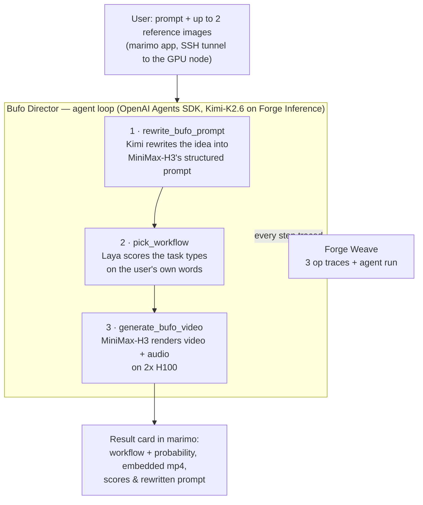
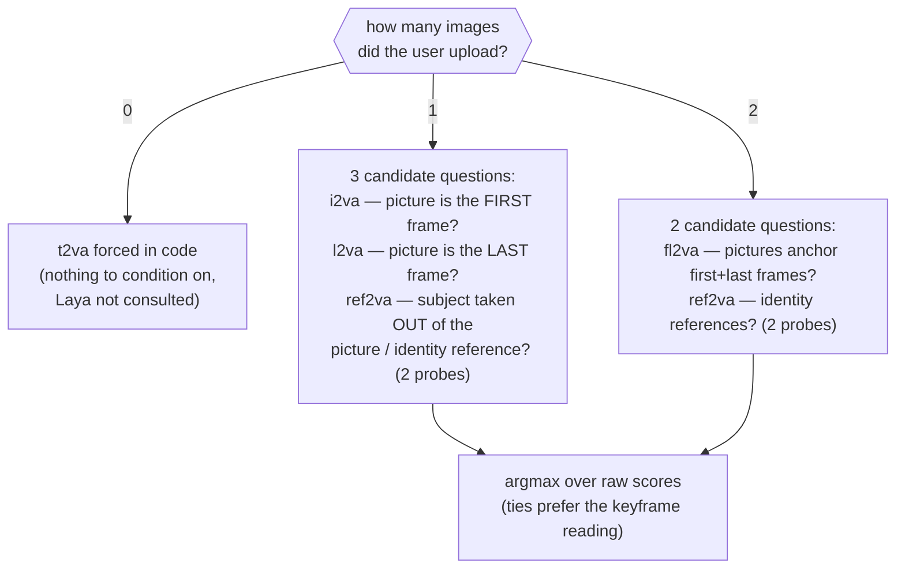
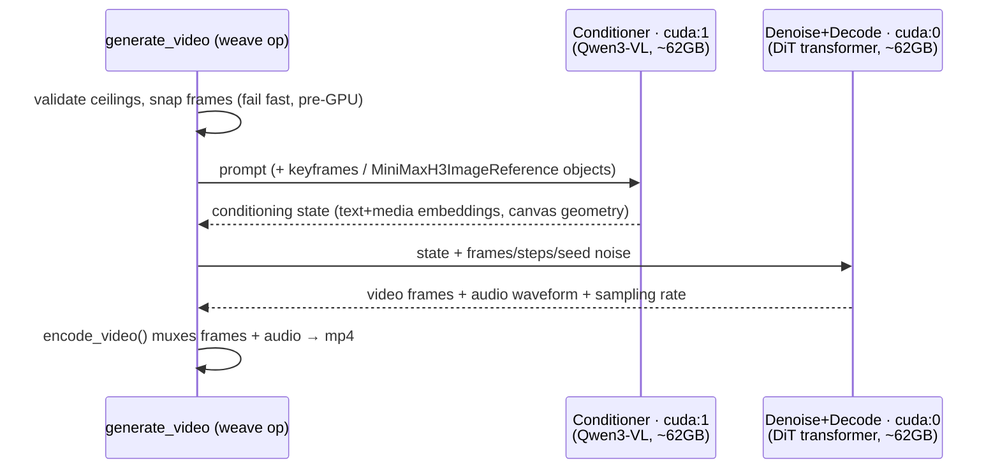

# How a Bufo video gets made

This document walks one generation end-to-end: from the sentence a user types
into the marimo app to the finished video+audio clip, detailing how each Forge
service is used along the way.

**Forge services used:**

| Service | Role here | Link |
|---|---|---|
| Forge Inference | Hosts `moonshotai/Kimi-K2.6` — the director agent's brain and the prompt rewriter | [model catalog](https://wandb.ai/inference) · endpoint `https://api.inference.wandb.ai/v1` |
| Forge Weave | Traces every step, renders inputs/outputs (images, video), agent observability | [traces](https://wandb.ai/wandb-smle/jb_bufo_gen/weave/traces) · [Agents view](https://wandb.ai/wandb-smle/jb_bufo_gen/weave/agents) |
| CoreWeave SUNK (Slurm) | The 2× H100 allocation the app and MiniMax-H3 run on | per-job Grafana dashboard (link printed by `scripts/launch_cluster.sh`) |

Models: [MiniMax-H3](https://huggingface.co/MiniMaxAI/MiniMax-H3) (video+audio
generation) and [Laya](https://huggingface.co/convaiinnovations/laya) (routing)
run locally on the allocation; Kimi-K2.6 is called over the network via Forge
Inference.

## The big picture



Each **Generate** click produces exactly three Weave traces (`rewrite_prompt`,
`select_workflow`, `generate_video`) plus one agent conversation in the Agents
view.

## The agentic layer

The orchestrator is a single agent — the **Bufo Director** — built on the
OpenAI Agents SDK with `Kimi-K2.6` as its model, served from Forge Inference
through the SDK's OpenAI-compatible client (auth = `WANDB_API_KEY`, usage
attributed to the Weave project via the `OpenAI-Project` header). Defined in
`src/bufo_gen/director.py`.

Design decisions worth knowing:

- **Three tools, fixed order.** The director is instructed to call
  `rewrite_bufo_prompt` → `pick_workflow` → `generate_bufo_video` exactly once
  each, then reply with a one-sentence summary (an Agents SDK run must end with
  a text message; the UI doesn't display it, but it appears in the trace and in
  error reports).
- **State passing, not argument passing.** The tools communicate through a
  shared `BufoRun` dataclass (prompt, image paths, canvas, results) rather than
  having the model re-emit long strings as tool arguments — an LLM re-typing a
  2,000-character prompt verbatim is a failure mode we avoid by construction.
- **Errors are surfaced, never swallowed.** A custom `failure_error_function`
  passes the real exception text back to the model (the SDK default hides it),
  and the director is instructed to report failures honestly instead of
  claiming success. The UI independently fails loudly if no video file exists.
- **The creative work is delegated.** The director itself only orchestrates;
  the actual prompt rewriting is a separate Kimi call inside the rewrite tool
  (see below). Same model, different system prompt, separately traced.
- **Guardrails live outside the agent.** Canvas size, duration and step count
  come from UI presets/inputs validated against measured hardware ceilings — a
  creative model can never pick a configuration that OOMs the GPUs.

## Step 1 — Forge Inference rewrites the prompt

MiniMax-H3 wants a very specific prompt shape, not casual English. The
`rewrite_prompt` op (`director.py`) sends one chat completion to
`https://api.inference.wandb.ai/v1` with:

- **System prompt:** the condensed MiniMax-H3 prompt-writing guide
  (`src/bufo_gen/prompt_guide.py`, derived from
  [`docs/minimax_prompt_guide.md`](minimax_prompt_guide.md)) plus instructions
  to star Bufo, be cinematic, and pick the right format from the uploads.
- **User message:** the raw request, the image count, and the clip duration
  (so timestamps and keyframe alignment come out right).

Kimi returns the structured prompt — labeled sections like
`integrated_multimodal_description` with `[Shot N]` blocks, explicit camera
motion (type + amplitude + speed), diegetic sounds inline,
`overall_soundscape`, and `non_diegetic_music`. Because MiniMax-H3 generates
the **soundtrack from the same prompt**, the rewrite quality directly shapes
the audio, not just the visuals.

Trace: [`rewrite_prompt`](https://wandb.ai/wandb-smle/jb_bufo_gen/weave/traces)
— inputs: `user_prompt`, `model`, `n_images`, `duration_s`; output: the
rewritten prompt.

## Step 2 — Laya ("System 1") decides the MiniMax task

[Laya](https://huggingface.co/convaiinnovations/laya) is a **non-autoregressive
classifier** — a 421M-parameter ModernBERT-large encoder with a scoring head,
not a text generator. It answers only the questions we define, from the options
we offer, which makes routing safe by construction: it physically cannot answer
outside the option set. It runs locally in-process (CPU-friendly, ~843MB
checkpoint) in `src/bufo_gen/classifier.py`.

**Input shaping.** Each question becomes one token sequence —

```
[CLS] noul question: <instructions> [SEP] [MASK] false: ... [MASK] true: ... [SEP] <user prompt> [SEP]
```

— encoded in a single bidirectional pass; a small head reads each option's
`[MASK]` position into one logit, and a calibrated-temperature softmax turns
them into probabilities. All questions for a request are answered in **one
batched forward pass** (~20 ms-class latency, "System 1").

**The question design.** Every candidate task type gets its own independent,
positively-phrased binary question — no "X rather than Y" contrasts, which
probing showed to be phrasing-brittle. A class may have several paraphrased
probes; its score is the max over them. The upload count fixes the candidate
set in code, so Laya is never offered an impossible option:



The trace records both the **raw per-class scores** (what Laya actually said)
and the normalized probabilities over all five classes, plus each class's
description — so the decision is fully auditable in Weave.

Note what Laya does *not* see: the images themselves (only their count) and the
rewritten prompt (routing runs on the user's own words, where intent like
"starting from my image" lives).

## Step 3 — MiniMax-H3 renders the clip

[MiniMax-H3](https://huggingface.co/MiniMaxAI/MiniMax-H3) is a ~124GB (bf16)
joint **video+audio** diffusion model, driven through diffusers **Modular
Pipelines** in `src/bufo_gen/generator.py`.

### Task types

The prompt guide distinguishes five task framings; the pipeline implements
three workflow graphs. `i2va`/`l2va` are the `fl2va` graph fed with only one
keyframe:

| Task | Meaning | Pipeline graph | Prompt format |
|---|---|---|---|
| `t2va` | text → video+audio | `t2va` | 3 sections |
| `i2va` | uploaded picture = first frame; video animates outward from it | `fl2va` (start keyframe only) | 3 sections + "Picture 1 aligns with the 0.00-second mark" |
| `l2va` | uploaded picture = last frame; video **converges onto** it | `fl2va` (end keyframe only) | 3 sections + final-frame anchor at the clip duration |
| `fl2va` | two pictures anchor first and last frames | `fl2va` (both keyframes) | 3 sections + both alignment marks |
| `ref2va` | picture(s) are identity references; the subject appears in a **new scene** | `ref2va` | 6 sections (`subject_definitions`, `summary`, `retention_analysis`, `detailed_description`, soundscape, music) with `<Picture N>`/`<Subject N>` labels |

Keyframes are *stretched onto the target canvas*; references are abstracted
("appearance from `<Picture 1>`") and can speak, move and change pose.
MiniMax-H3 is **guidance-distilled**: there is no negative prompt and no
guidance scale to tune.

### Hard limits (measured on this hardware)

- `height × width × num_frames ≤ ~53M` pixel-frames — above this the denoise
  GPU OOMs. Validated at generation time *and* by import-time asserts on the
  UI presets (`src/bufo_gen/config.py`).
- Frame counts snap to `17n + 5` (what the video VAE can decode), between 124
  and 345 frames — i.e. 5.0–14.4 s at the fixed 24 fps.
- At most **2** reference images — a third OOMs the conditioner GPU.
- `num_inference_steps` defaults to the model's 50; it's the quality↔speed
  knob exposed under "Advanced parameters".

### Execution



The pipeline is split across the two H100s: the **Qwen3-VL conditioner**
encodes the prompt and any images on `cuda:1`; the **DiT transformer**
denoises and decodes on `cuda:0`. Audio comes out of the same diffusion pass
as the frames and is muxed into the mp4. Output lands in `generated_videos/`
and is returned as the op's output, typed so Weave renders it playable.

## Forge Weave keeps the receipts

`src/bufo_gen/tracing.py` initializes Weave once per process:
`weave.init("wandb-smle/jb_bufo_gen")` auto-patches both the OpenAI client
(every Kimi completion is captured) and the Agents SDK (agent runs stream to
the Agents view via an OTel processor). Two rules keep this working: never
call `set_tracing_disabled(True)` (it silently no-ops *all* span creation) and
never call `set_trace_processors(...)` after `weave.init()` (it would wipe
Weave's processor).

What lands where, per generation:

- **[Traces](https://wandb.ai/wandb-smle/jb_bufo_gen/weave/traces)** — the
  three ops with full inputs/outputs. Uploaded reference images are passed as
  PIL images, so they render *viewable* on the `generate_video` trace; the
  output mp4 renders *playable*. The Kimi completion nests under
  `rewrite_prompt`.
- **[Agents view](https://wandb.ai/wandb-smle/jb_bufo_gen/weave/agents)** —
  one conversation per generation: the director's model turns, tool calls,
  token usage, cost, and error rate across runs.

Debugging heuristics: `n_images: 0` on `select_workflow` means the upload never
reached the server (uploads reset on app restart/page reload); image inputs
appear only on image-bearing workflows; a completed agent run with no
`generate_video` trace means the generation tool errored — the real error text
is in the agent conversation.

## GPU backend

- **What it runs on:** one Slurm allocation (`scripts/launch_cluster.sh`) with
  **2× NVIDIA H100 80GB**, 16 CPUs, 200GB RAM on the CoreWeave SUNK cluster.
  The marimo app, Laya, and MiniMax-H3 all live inside this allocation; Kimi
  is the only remote model.
- **Why two H100s:** the model is ~124GB in bf16 — ~62GB Qwen3-VL conditioner
  + ~62GB DiT transformer — so it cannot fit a single 80GB card; the pipeline
  splits conditioner→`cuda:1`, denoise/decode→`cuda:0`. That is the practical
  minimum footprint for this model at bf16; smaller setups would need
  quantization or offload schemes this app doesn't implement.
- **Loading behavior:** weights download from the HF Hub once (cached on the
  cluster home dir), then load lazily on the **first generation per workflow
  per process** (several minutes) and stay resident. `i2va`/`l2va`/`fl2va`
  share one partition; `t2va` and `ref2va` each load their own. App restarts
  drop the cache.
- **Throughput:** ~1.9 s per denoise step at the default 832×480×124-frame
  preset — roughly 1.5–2 minutes of denoising at 50 steps, plus prompt/media
  conditioning and mp4 encode. The fast 384×384 preset denoises in under a
  minute.
- **Monitoring:** GPU utilization/memory per job on the SUNK Grafana dashboard
  (link printed at launch); app logs in `logs/marimo.log`.
